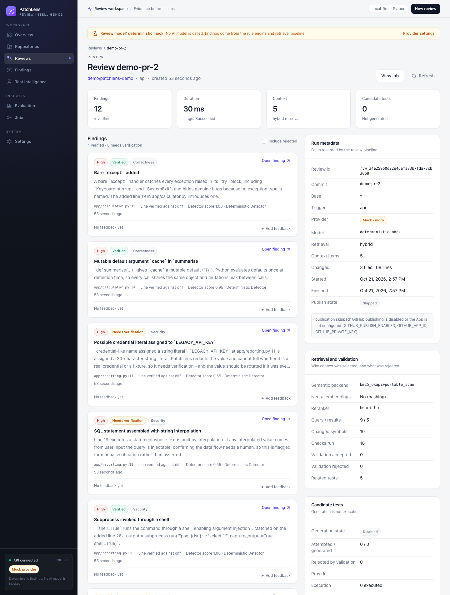
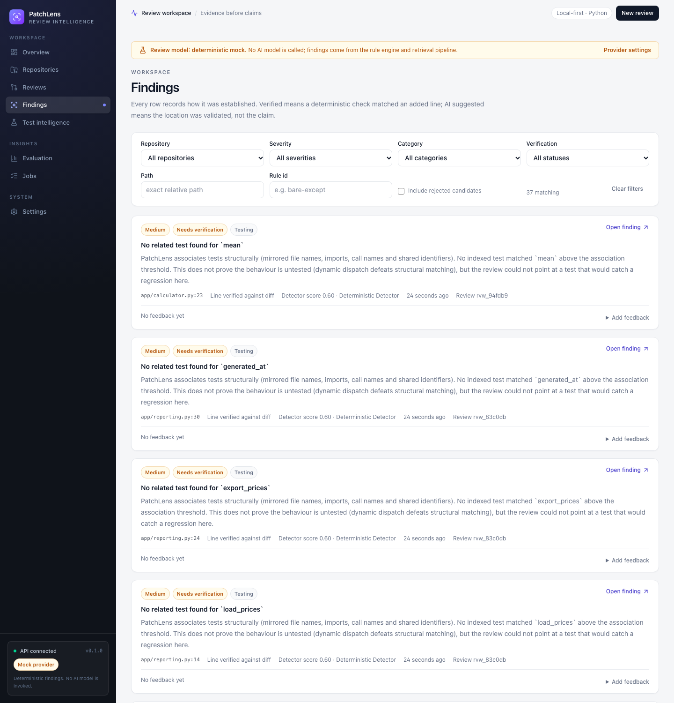
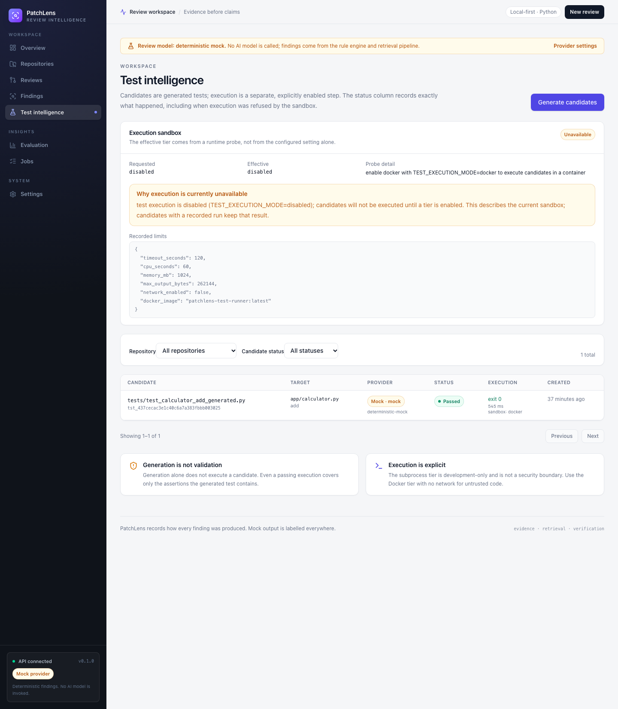
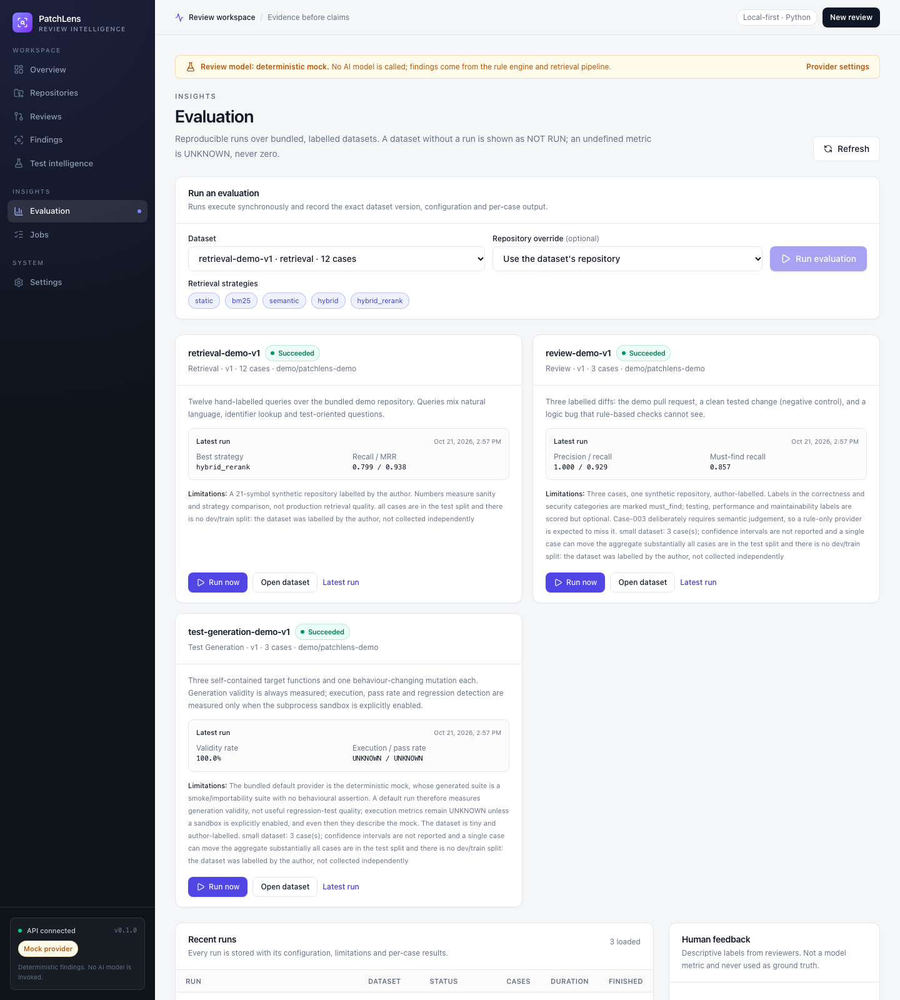
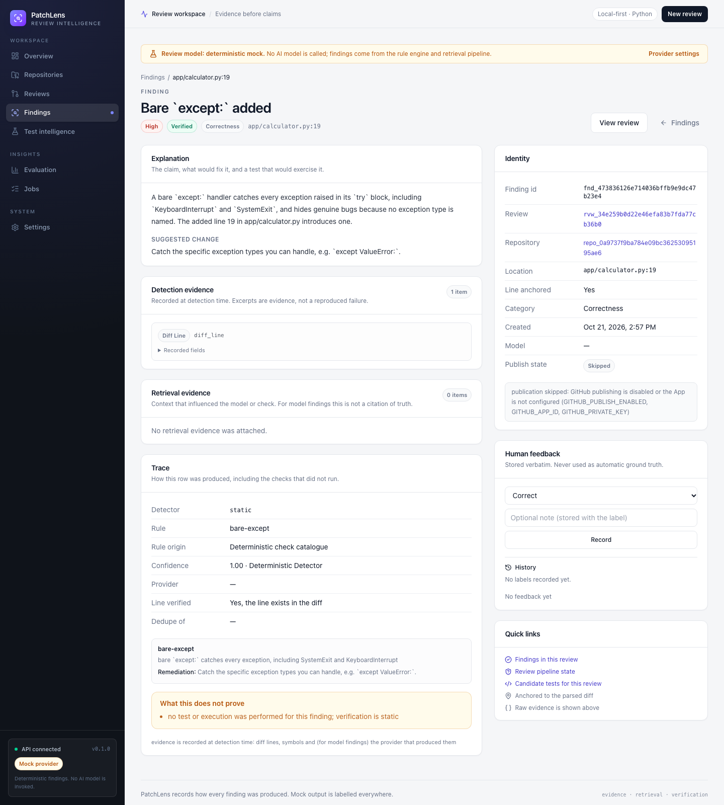
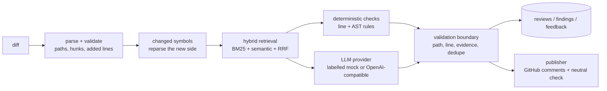

# PatchLens

### AI-assisted code review that shows its evidence.

PatchLens is a full-stack, repository-aware code review platform. It reads a pull-request
diff, retrieves the callers, tests and docs that matter, runs deterministic checks, asks
an LLM only where judgement is needed, and **verifies every finding against the diff
before showing it**.

It is built to answer a question most AI review tools avoid: *why should a reviewer trust
this comment?*


<p>
  
  
  
  
  
  
  
</p>

> **Portfolio project.** The default configuration runs with no paid credentials: SQLite,
> a deterministic mock LLM, and hashing embeddings. The mock is labelled as a mock in the
> API, the CLI, the dashboard and the database. PostgreSQL + pgvector, Redis, a real
> OpenAI-compatible model, GitHub publishing and a Docker test sandbox are opt-in.

[Measured results](#measured-results) · [Architecture](#architecture) · [Run the demo](#run-the-demo) · [Documentation](#documentation)

---

## The problem

AI code review is easy to demo and hard to trust. A model can produce a confident comment
about a file it never read, point at a line that does not exist, or miss the caller that
makes a change dangerous. Reviewers then spend time checking the reviewer.

PatchLens treats review output as a claim that must be validated:

- every finding must anchor to a **line the diff actually added**;
- every path must exist in the repository;
- every cited snippet must appear in the reviewed content;
- duplicate and unsafe findings are rejected, with the reason kept;
- findings that need human judgement say so instead of pretending to be confirmed;
- missing metrics are `UNKNOWN` or `NOT RUN`, never zero.

That constraint shapes the whole system: retrieval, prompting, validation, persistence,
the API and the UI.

---

## What it does

| Capability | What it means in practice |
| --- | --- |
| **Repository intelligence** | Parses Python with `ast`: modules, classes, functions, signatures, docstrings, imports, call edges and tests. Creates immutable snapshots keyed by commit SHA. |
| **Hybrid retrieval** | BM25, semantic search, reciprocal-rank fusion and a documented heuristic reranker. Five strategies share one interface so they can be compared on the same corpus. |
| **Review pipeline** | Diff validation → changed-symbol mapping → context retrieval → deterministic rules → optional LLM review → evidence validation → persisted findings. |
| **Test intelligence** | Generates candidate regression tests from changed or indexed symbols, then executes them only when an explicit sandbox tier is enabled. |
| **Evaluation harness** | Versioned, content-hashed datasets for retrieval, review and test generation, with stored per-case results and honest handling of undefined metrics. |
| **GitHub App** | HMAC-verified webhooks, delivery deduplication, App authentication, diff fetch, PR comments and a neutral check run. Publishing is off by default. |
| **Dashboard** | Next.js App Router UI for overview, repositories, reviews, findings, tests, evaluation, jobs and settings, with real loading/error/empty states. |
| **Operations** | Durable database-backed jobs with leases, retries, backoff, cancellation and deduplication; optional Redis wake-ups; health probes; Alembic; Compose; CI. |

---

## Product tour

| Overview | Review detail |
| --- | --- |
|  |  |
| **Findings** | **Test intelligence** |
|  |  |
| **Evaluation** | **Finding trace** |
|  |  |

Twelve full-size screenshots are in [`docs/screenshots/`](docs/screenshots/).

---

## Architecture



| Layer | Technology |
| --- | --- |
| API | FastAPI, Pydantic v2, SQLAlchemy 2, Alembic |
| Data | SQLite locally; PostgreSQL 16 + pgvector in Compose |
| Jobs | Durable `jobs` table, worker leases/retries; Redis is an optional wake-up hint |
| Retrieval | In-process BM25, cosine similarity, reciprocal-rank fusion, heuristic rerank |
| Models | Deterministic mock by default; OpenAI-compatible LLM and embeddings opt-in |
| Frontend | Next.js 16 App Router, React 19, TypeScript strict, Tailwind CSS 4 |
| Isolation | Opt-in Docker test runner with no network, read-only mounts and resource limits |
| CI | GitHub Actions: backend lint/type/test, migrations, frontend lint/typecheck/test/build |

---

## The hard parts

### 1. A validation boundary, not a prompt instruction

The LLM is never trusted to invent structure. Candidate findings are validated against
the parsed diff and the repository snapshot. A finding that cannot be anchored is stored
as `rejected` with a reason, so the trace endpoint can explain why a suggestion was
discarded. The UI hides rejected candidates unless the reviewer explicitly enables
"Include rejected", and shows the reason when they do.

### 2. Durable work, not a background task

Reviews and indexing run through a database-backed queue with leases, heartbeat
recovery, retries with backoff, terminal-state deduplication and cancellation. Redis is
only a low-latency wake-up channel; losing Redis cannot lose work. The worker is a
separate process from the API.

### 3. Retrieval that can be evaluated

Five retrieval strategies share one interface, so the evaluation harness can run the same
12 labelled queries through each one. The reranker is a fixed, documented heuristic — not
a trained cross-encoder — and the README and API say so.

### 4. Test execution with explicit tiers

Generated tests are never assumed to have run. Execution is `disabled` by default,
opt-in `subprocess` (explicitly not a security boundary), or `docker` with no network,
read-only repository/test mounts, dropped capabilities, a read-only root, a tmpfs,
memory/CPU/PID limits and a timeout. A missing daemon or image is recorded as an error,
never a pass.

### 5. Honest degradation

If embeddings fail, retrieval falls back to lexical search and records a warning. If the
LLM fails, deterministic findings are still persisted and the review is marked
failed/degraded with the provider error. The dashboard distinguishes "this candidate
passed in Docker earlier" from "the sandbox is currently disabled".

---

## Measured results

Measured on 2026-10-21. Full methodology, dataset hashes and per-case analysis are in
[`docs/EVALUATION.md`](docs/EVALUATION.md).

| Area | Result |
| --- | --- |
| Backend test suite | **455 passed**, **87%** statement coverage (8784 statements) |
| Backend quality gates | ruff clean (124 files), mypy strict clean (89 source files) |
| Frontend | **26 tests passed**; lint, typecheck and production build clean |
| Compose stack | PostgreSQL 16 + pgvector, Redis, migrate, API and worker; `/readyz` 200 |
| Docker test runner | Generated candidate **passed**, exit 0, **3 tests**, **545 ms**, network disabled |
| Retrieval evaluation | `hybrid_rerank`: nDCG@10 **0.833**, MRR@10 **0.938**, Recall@5 **0.799** over 12 queries |
| Review evaluation | Precision **1.000**, recall **0.929**, F1 **0.963**, must-find recall **0.857** over 3 labelled diffs |
| Test generation evaluation | Validity **3/3**; execution **UNKNOWN** because the sandbox was disabled |

These numbers measure the deterministic layer with a labelled mock provider and
non-neural hashing embeddings. They are not evidence of LLM review quality. Undefined
metrics are stored and rendered as `UNKNOWN`; a dataset without a run is `NOT RUN`.

---

## Run the demo

**Requirements:** Python 3.11 and `make`. Docker and Node.js are optional.

```bash
make setup          # create .venv and install locked dependencies
make init-db        # create the SQLite schema
make demo-repo      # register and index examples/demo-repo
make demo-review    # review the bundled pull request
```

The demo prints each finding with its rule id, verification status and diff anchor. The
bundled PR produces **12 findings: 4 verified and 8 needing manual verification**, with
the mock provider clearly labelled.

### Dashboard

```bash
# terminal 1
make run            # API at http://127.0.0.1:8000

# terminal 2
make worker         # durable job worker

# terminal 3
make frontend-install
PATCHLENS_API_URL=http://127.0.0.1:8000 make frontend-dev
# http://127.0.0.1:3000
```

The browser never receives the API token: the dashboard proxies through a same-origin
Next.js route that injects it server-side.

### Full stack with Docker

```bash
make compose-up
curl -s http://127.0.0.1:8000/readyz
```

This runs PostgreSQL 16 + pgvector, Redis, migrations, the API and a worker. Demo fixtures
and evaluation datasets are mounted read-only inside the containers.

### Review your own diff

```bash
cd backend

../.venv/bin/python -m patchlens.cli repo-add \
  --owner your-org --name your-service \
  --local-path /absolute/path/to/your-service

../.venv/bin/python -m patchlens.cli index \
  --repository-id repo_... \
  --commit-sha "$(git -C /absolute/path/to/your-service rev-parse HEAD)"

../.venv/bin/python -m patchlens.cli review \
  --repository-id repo_... \
  --diff-file /absolute/path/to/change.diff \
  --commit-sha pr-head
```

The same workflow is available from **Reviews → New review** in the dashboard. Run
`make help` for every entry point.

---

## What this project demonstrates

- **Full-stack product engineering** — Python API, durable workers, relational schema,
  migrations, a typed React dashboard, Docker Compose and CI.
- **Retrieval and evaluation discipline** — multiple strategies behind one interface,
  versioned datasets, stored runs, and metrics that are allowed to be `UNKNOWN`.
- **LLM systems engineering** — repository context assembly, provider abstraction,
  deterministic fallback, evidence validation and explicit mock labelling.
- **Security-aware execution** — diff path validation, payload limits, secret redaction,
  prompt-injection handling and an opt-in sandbox.
- **Product judgement** — a UI that distinguishes verified findings from suggestions and
  a disabled sandbox from a passing test run.

---

## Project layout

```text
backend/
  patchlens/
    api/            FastAPI app, routes, dependencies, error mapping
    core/           settings, enums, errors, security, logging
    db/             SQLAlchemy models, sessions, custom types
    jobs/           durable queue, worker loop, Redis wake-ups, handlers
    services/
      ingestion/    discovery, Python AST parser, indexer
      retrieval/    BM25, semantic, fusion, service, strategies
      review/       diff parser, symbol mapping, checks, prompting, validation, pipeline
      llm/          provider interface, mock, OpenAI-compatible client
      embedding/    hashing and OpenAI-compatible providers
      testing/      candidate generation, sandbox resolution, execution
      github/       GitHub client, webhook ingestion, publisher
    cli.py          operational CLI
  migrations/       Alembic revisions
  eval/datasets/    versioned evaluation datasets
  tests/            unit, integration and security tests
frontend/           Next.js App Router dashboard
docker/test-runner/ minimal pytest image for the Docker execution tier
examples/demo-repo/ fixture service and pull request used by the demo
docs/               architecture, security, evaluation, GitHub, screenshots, run payloads
```

---

## Documentation

| Document | Contents |
| --- | --- |
| [docs/ARCHITECTURE.md](docs/ARCHITECTURE.md) | Components, data flow, schema, retrieval and job design. |
| [docs/SECURITY.md](docs/SECURITY.md) | Threat model, auth, path/payload validation, prompt injection, sandboxing. |
| [docs/EVALUATION.md](docs/EVALUATION.md) | Dataset provenance, metrics, recorded runs, per-case analysis. |
| [docs/GITHUB.md](docs/GITHUB.md) | GitHub App setup, permissions, publication and failure semantics. |
| [docs/RESUME.md](docs/RESUME.md) | Portfolio bullets with measured numbers. |
| [docs/screenshots/](docs/screenshots/) | Twelve dashboard screenshots. |
| [docs/eval/](docs/eval/) | Stored evaluation run payloads. |

---

## Limitations

PatchLens is a portfolio project, not a production service. The important limits:

- **No live GitHub installation.** Webhooks, App auth, diff fetch, publication and the
  check run are covered by integration tests against a mocked GitHub API with a generated
  RSA key. Remote cloning is not implemented; reviews require a registered local checkout.
- **Publishing is at-least-once.** A crash after GitHub accepts a review but before the
  database commit can duplicate it.
- **pgvector is executed but not ANN-indexed.** The vector column is unconstrained and
  there is no HNSW index, so semantic search is an exact cosine scan.
- **The Docker sandbox is defense in depth, not a proof.** It relies on the host Docker
  daemon and the default seccomp profile. The subprocess tier is not a security boundary.
- **No load or soak test.** Recorded latencies are single-process measurements, not
  capacity evidence.
- **Evaluation is small and mock-based.** Labels are author-written over a 21-symbol
  fixture and three diffs; no independent label review.
- **The mock provider is not AI, and hashing embeddings are not semantic.** Both are
  deterministic development defaults, labelled everywhere.

## What I would build next

- A fixed-dimension pgvector column with an HNSW index and a migration that backfills.
- A live GitHub App installation path, including remote checkout and a real delivery
  smoke test.
- A trained cross-encoder reranker evaluated against the current heuristic.
- Load/soak testing for the worker and API, with queue-depth and latency dashboards.
- Additional language parsers behind the existing indexing interface.
