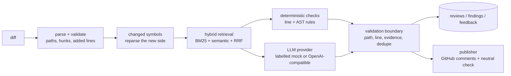

# PatchLens

Repository-aware, AI-assisted code review with test intelligence.

PatchLens reviews a pull-request diff the way a careful reviewer with repository
access would: it finds the changed symbols, retrieves the callers, tests and docs
that matter, runs deterministic checks, asks an LLM for judgement calls, and then
verifies every location it wants to publish before it publishes anything.

The project is built to be honest about what it knows. Findings are labelled
`verified`, `ai_suggested`, `needs_manual_verification` or `rejected`; a finding
that cannot be anchored to a line the diff actually added is discarded rather than
shown with an invented location. Runs without paid credentials use a deterministic
mock provider that is labelled as a mock in the API, the CLI and the UI model.

## Status

| Area | State |
| --- | --- |
| Milestone 1 — foundation, settings, DB, durable job queue, worker | done |
| Milestone 2 — Python AST ingestion, versions, embeddings, test mapping | done |
| Milestone 3 — diff → retrieval → checks → LLM → validation → API/CLI | done |
| Milestone 4 — retrieval evaluation (metrics, datasets, runner) | done — first runs recorded |
| Milestone 5 — GitHub App webhooks and comment publication | done — tested against a mocked GitHub API |
| Milestone 6 — test generation and sandboxed execution | not started |
| Milestone 7 — reliability/security hardening pass | not started |
| Milestone 8 — web frontend, docs, screenshots, demo polish | not started |

Known environment limits are listed at the end of this file. In short: Docker was
not available while this was developed, so the PostgreSQL/pgvector and Redis paths
are implemented but have not been executed here, and the Docker sandbox tier for
test execution does not exist yet.

## Quick start (no Docker, no credentials)

Requires Python 3.11.

```bash
make setup          # create .venv and install the locked dependencies
make init-db        # create a SQLite database under backend/var/
make demo-repo      # register + index examples/demo-repo (a real fixture project)
make demo-review    # review examples/demo-repo/pr.diff
```

`make demo-review` prints findings with their rule id, verification status and
anchor. With the default mock provider the output is deterministic, and every
finding is derived from the diff and the indexed repository — not generated prose.

Inspect the same data over HTTP:

```bash
make run            # http://127.0.0.1:8000  (OpenAPI at /docs)
curl -s localhost:8000/api/v1/meta | jq
curl -s localhost:8000/api/v1/repositories | jq
```

Start a worker to process queued jobs (the API queues reviews by default):

```bash
make worker
```

Everything above uses SQLite, a database-backed job queue, the deterministic mock
LLM and deterministic hashing embeddings. No external services are required.

## What a review actually does



Two properties are enforced in code rather than documented as intentions:

1. **No invented locations.** Every persisted finding must point at a line the diff
   added, an existing path inside the repository, and evidence that exists in the
   reviewed content. Rejected candidates keep the reason, so the trace endpoint can
   explain why a suggestion was thrown away.
2. **Degradation is explicit.** If embeddings fail, retrieval falls back to lexical
   search and the review records a warning. If the LLM fails, deterministic
   findings are still persisted and the review is marked failed/degraded with the
   provider error. Neither case silently produces a smaller, unlabelled result.

## Repository intelligence

- Python is parsed with `ast`: modules, classes, functions, methods, docstrings,
  signatures, line ranges, imports, call edges and test functions.
- Each index run creates an immutable `repository_version` keyed by commit SHA (or
  a content hash for local checkouts). Re-indexing an unchanged tree short-circuits.
- Embeddings are content-addressed, so unchanged symbols are reused across versions
  instead of re-embedded.
- Test files are structurally mapped to source symbols (imports, mirrored package
  paths, name pairs, call edges) with fixed, documented weights.
- Vendored/build/cache directories, binary files and secret-looking dotfiles are
  excluded before parsing.

## Retrieval

Five strategies share one interface so they can be compared on the same corpus:

| Strategy | What it does |
| --- | --- |
| `static` | exact identifier/path matching (unranked baseline) |
| `bm25` | BM25 Okapi implemented in-process (`k1=1.5`, `b=0.75`) |
| `semantic` | cosine similarity over stored vectors |
| `hybrid` | reciprocal rank fusion of BM25 and semantic (`k=60`) |
| `hybrid_rerank` | hybrid candidates re-scored by a documented heuristic reranker |

The reranker is a weighted heuristic, **not** a trained cross-encoder; the code and
the API say so. On SQLite, semantic search is an in-process scan (`portable_scan`);
on PostgreSQL it is intended to use pgvector. The fixed-dimension pgvector column
and HNSW index are a planned migration, so the Postgres semantic path has not been
exercised yet.

Embeddings have two providers: `hashing` (deterministic feature hashing, explicitly
non-neural) and `openai_compatible` (a real neural embedding endpoint, opt-in with
credentials). Each stored embedding records which one produced it, so a mock/hashing
index can never masquerade as a neural one.

## Evaluation

`backend/eval/datasets/` holds two versioned, content-hashed datasets: 12 graded
retrieval queries and 3 labelled diffs (the demo PR, a clean negative control, and
an off-by-one logic bug the rules cannot see). `make eval-seed && make eval-run`
records the runs; the API serves the same stored rows.

First recorded runs on the bundled demo repo (SQLite, hashing embeddings, mock
provider), 2026-10-20:

| Run | Result |
| --- | --- |
| retrieval — 12 queries, five strategies | best nDCG@10 `hybrid_rerank` 0.833; MRR@10 0.938; Recall@5 0.799 |
| review — 3 diffs, mock provider | precision 1.000, recall 0.929 (13 tp, 0 fp, 1 fn); must-find recall 0.857 |

The single miss is reported rather than tuned away: an off-by-one in `mean()` is a
semantic defect no deterministic rule detects. Cost is `UNKNOWN` (no priced provider
was configured). These numbers measure the deterministic layer with a labelled
rule-based provider and a non-neural embedding signal — not an LLM. Full tables,
dataset hashes, run ids, per-case analysis and reproduction commands are in
[docs/EVALUATION.md](docs/EVALUATION.md). Undefined metrics render as `UNKNOWN`;
a dataset without a run is `NOT RUN`.

## GitHub integration

GitHub App webhooks are verified against the raw body (`X-Hub-Signature-256`) and
deduplicated by `X-GitHub-Delivery`. `pull_request` `opened`/`reopened`/`synchronize`
events resolve a registered local checkout, queue one review per head SHA, fetch the
diff with an installation token, run the normal review pipeline, and publish:

- one pull-request **review with `event: COMMENT`** — never an approval or a change
  request;
- inline comments only for `verified` and `needs_manual_verification` findings, only
  configured severities, verified added-line anchors and safe paths, capped by
  `GITHUB_MAX_COMMENTS_PER_REVIEW`;
- a **neutral** check run whose annotations mirror the published findings.

Every finding records `publish_state` (`published` / `skipped` / `failed`) with a
reason, and comment text excludes raw code excerpts and passes secret redaction.
The App asks for metadata read, pull-requests write and checks write — no contents,
code write, workflows, secrets or administration. Setup, permissions, failure
semantics and the untested paths are in [docs/GITHUB.md](docs/GITHUB.md).

The local demo does not need a GitHub App: `make demo-review` exercises the same
pipeline with publication recorded as `skipped`. No live GitHub App installation has
been exercised here; the integration tests drive the real webhook route, queue,
worker and publisher against an `httpx.MockTransport` GitHub API and a generated RSA
key.

## Findings and feedback

Each finding carries: category, severity, rule id, detector (`static`, `static_ast`,
`llm`), verification status, confidence basis, path, line range, evidence and a
rejection reason when it was discarded. Feedback labels (`correct`, `incorrect`,
`irrelevant`, `duplicate`, `needs_investigation`) are stored per finding and
aggregated; nothing is retrained from them automatically.

`GET /api/v1/findings/{id}/trace` returns the full story: the rule definition, the
detector, whether the cited line was verified against the diff, the evidence, and a
`not_executed` list naming what PatchLens did **not** verify (for example "no test
execution was attempted").

## API

All routes are under `/api/v1` except the probes. `Authorization: Bearer <token>` is
required when `API_AUTH_TOKEN` is set; `/healthz`, `/readyz`, `/api/v1/meta` and the
HMAC-authenticated `POST /api/v1/github/webhooks` remain public so an orchestrator
can probe the process, a UI can discover that a token is required, and GitHub can
deliver events without a bearer token.

| Method | Path | Purpose |
| --- | --- | --- |
| GET | `/healthz`, `/readyz` | liveness, readiness (DB included) |
| GET | `/api/v1/meta` | version, capabilities, provider mode, rule catalogue |
| GET/POST | `/api/v1/repositories` | list / register a local checkout (development only) |
| GET/DELETE | `/api/v1/repositories/{id}` | detail / delete with its data |
| POST | `/api/v1/repositories/{id}/index` | queue an index job |
| GET | `/api/v1/repositories/{id}/versions` | index snapshots |
| POST | `/api/v1/reviews` | review a diff (`wait=true` runs in-request) |
| GET | `/api/v1/reviews`, `/api/v1/reviews/{id}` | list / detail |
| GET | `/api/v1/reviews/{id}/findings` | findings for a review |
| GET | `/api/v1/findings/{id}` | finding detail |
| GET | `/api/v1/findings/{id}/trace` | why the finding exists, and what was not checked |
| POST/GET | `/api/v1/findings/{id}/feedback` | record / list feedback |
| GET | `/api/v1/findings/feedback/aggregate` | aggregate label counts |
| GET | `/api/v1/evaluation/datasets`, `/api/v1/evaluation/datasets/{id}` | labelled datasets and their cases |
| GET/POST | `/api/v1/evaluation/runs` | list runs / run a dataset synchronously |
| GET | `/api/v1/evaluation/runs/{id}` | aggregate and per-case results |
| GET | `/api/v1/jobs`, `/api/v1/jobs/{id}` | durable job state and events |
| POST | `/api/v1/jobs/{id}/cancel` | cancel a queued job |
| POST | `/api/v1/github/webhooks` | GitHub webhook receiver (HMAC signature required) |
| GET | `/api/v1/github/installations` | installations observed from webhook events |
| GET | `/api/v1/github/deliveries` | webhook audit rows, optionally filtered by `status` |
| GET | `/api/v1/settings` | effective configuration, secrets masked |

Errors use one shape: `{"error": {"code", "message", "details"}}`, with codes such
as `validation_error`, `not_found`, `unauthorized`, `payload_too_large`,
`provider_error`.

## Configuration

Every setting has a working default. Copy `.env.example` to `.env` to change them;
the example file is generated from the settings model (`make env-example`, or
`python -m patchlens.cli config --write-env-example`).

| Variable | Default | Notes |
| --- | --- | --- |
| `ENVIRONMENT` | `development` | `production` forbids local checkout registration |
| `DATABASE_URL` | SQLite under `backend/var/` | `postgresql+psycopg://...` for Postgres |
| `REDIS_URL` | unset | optional wake-up channel; jobs live in the DB |
| `AUTO_CREATE_SCHEMA` | `true` | ignored in production; use Alembic there |
| `API_AUTH_TOKEN` | unset | when set, protects every data route |
| `LLM_PROVIDER` | `mock` | `mock` or `openai_compatible` |
| `LLM_BASE_URL`, `LLM_API_KEY`, `LLM_MODEL` | OpenAI defaults | used only by the real provider |
| `EMBEDDING_PROVIDER` | `hashing` | `hashing` (non-neural) or `openai_compatible` |
| `EMBEDDING_DIM`, `EMBEDDING_MODEL` | `512`, `hashing-ngram-v2` | changing these requires re-indexing |
| `RETRIEVAL_STRATEGY` | `hybrid` | one of the five strategies above |
| `GITHUB_APP_ID`, `GITHUB_PRIVATE_KEY`, `GITHUB_WEBHOOK_SECRET` | unset | GitHub App credentials; without all three the webhook returns 502 |
| `GITHUB_PUBLISH_ENABLED` | `false` | comments/check run are created only when explicitly enabled |
| `GITHUB_COMMENT_SEVERITIES` | `critical,high` | severity filter for inline comments |
| `GITHUB_MAX_COMMENTS_PER_REVIEW` | `10` | bounded comment count (1–50) |
| `GITHUB_REQUIRE_VERIFIED_ANCHORS` | `true` | publish only added-line-verified anchors |
| `GITHUB_API_BASE_URL` | `https://api.github.com` | configurable for GitHub Enterprise; only the mock base URL is tested |

The provider split is deliberate: the app runs, indexes and reviews without paid
credentials, and `is_mock_provider` is stored on each review so no surface can
present mock output as a real model's work. Set `LLM_PROVIDER=openai_compatible`
plus an API key and model to use a real model.

## Quality gates

```bash
make lint        # ruff format --check + ruff check
make typecheck   # mypy (strict) over the backend package
make test        # pytest
make test-cov    # pytest with a coverage report
make ci          # lint + typecheck + test
```

Current measured state on this machine (Python 3.11, SQLite): **389 tests pass**,
**88% statement coverage** (7550 statements, 724 missed), `ruff` and
`mypy --strict` clean. Run the commands yourself; the numbers in this file are
updated only after the commands have been run.

## Repository layout

```
backend/
  patchlens/
    api/            FastAPI app, routes, dependencies, error mapping
    core/           settings, enums, errors, security, logging
    db/             SQLAlchemy models, session, custom types, migrations helpers
    jobs/           durable queue, worker loop, job handlers
    services/
      ingestion/    discovery, Python AST parser, indexer
      retrieval/    BM25, semantic, fusion, service, strategies
      review/       diff parser, symbol mapping, checks, prompting, validation, pipeline
      llm/          provider interface, mock, OpenAI-compatible client
      embedding/    hashing and OpenAI-compatible embedding providers
      github/       GitHub client, webhook ingestion, publisher
    cli.py          operational CLI
  migrations/       Alembic revisions
  tests/            unit, integration, security
examples/demo-repo/ a small fixture service and a real diff used by `make demo-*`
docs/               architecture, security, evaluation, GitHub integration
```

## Honest limitations

- **No live GitHub run.** The webhook receiver, App JWT/installation-token flow,
  diff fetch, comment publication and neutral check run are implemented and covered
  by integration tests against a mocked GitHub API (`httpx.MockTransport`) with a
  generated RSA key. No real GitHub App installation has delivered an event here, and
  GitHub Enterprise is untested. Publication is off unless
  `GITHUB_PUBLISH_ENABLED=true`; without a publisher the review records
  `publish_state=skipped` with the reason. A crash after GitHub accepts a review but
  before the DB commit can duplicate the review (GitHub has no idempotency key);
  this is documented in [docs/GITHUB.md](docs/GITHUB.md).
- **No remote cloning.** Webhook review requires a registered local checkout and a
  successful index; unregistered/uncheckout repositories are recorded as failed
  deliveries rather than cloned.
- **No PostgreSQL/pgvector execution.** Docker was unavailable during development.
  The portable SQLite path is what the tests exercise. The pgvector column type is
  unconstrained until the planned fixed-dimension migration.
- **No test execution.** Test generation and sandboxed execution are milestone 6.
  No result in the current system claims that tests were run.
- **Evaluation is deliberately small and mock-based.** The recorded review run uses
  the deterministic mock provider; retrieval uses non-neural hashing embeddings on
  SQLite; labels are author-written over a 21-symbol fixture. The numbers are real,
  reproducible and published with their limits (run ids and dataset hashes in
  `docs/EVALUATION.md`) — they are not evidence of LLM review quality.
- **The mock provider is not AI.** It is a deterministic rule-based responder used
  to exercise the pipeline without credentials. Its output is labelled `mock`
  everywhere, including `reviews.is_mock_provider` and the API metadata.
- **Hashing embeddings are not semantic.** They are a deterministic lexical-ish
  signal for local development; the neural provider exists but has not been run here.
- **The heuristic reranker is not trained.** It applies fixed weights and is
  described as such in code and in `/api/v1/meta`.
