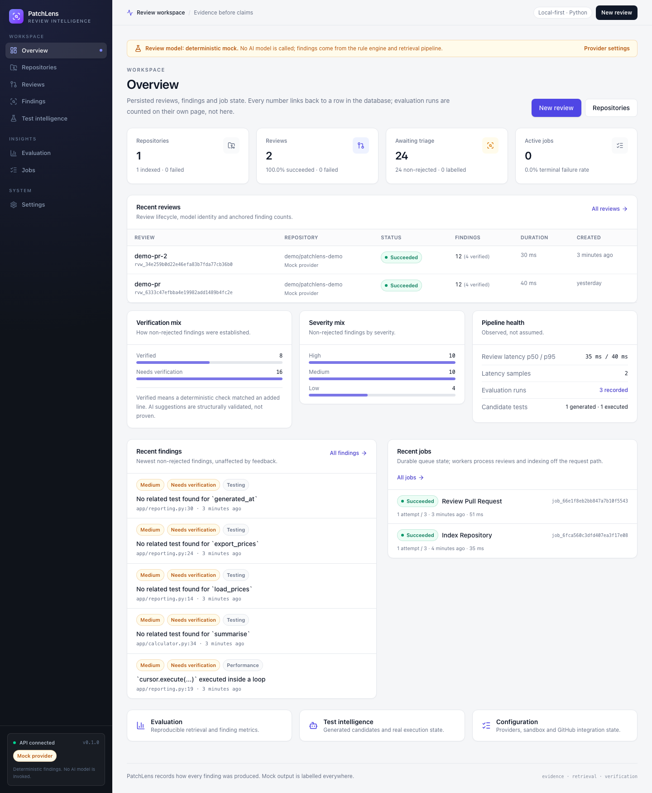
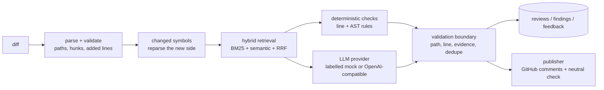

# PatchLens

**Repository-aware code review and test intelligence for Python pull requests.**

PatchLens reviews a diff the way a careful engineer with repository access would: it
finds the changed symbols, retrieves the callers, tests and docs that matter, runs
deterministic checks, asks an LLM only where judgement is needed, and verifies every
finding against the diff before showing it.

The default setup runs entirely on your machine with **no paid credentials**: SQLite,
a durable database-backed job queue, a deterministic mock LLM, and hashing embeddings.
PostgreSQL + pgvector, Redis, a real OpenAI-compatible provider, GitHub App publishing,
and a Docker test sandbox are all opt-in.



<p>
  
  
  
  
  
  
  
</p>

## Contents

- [Why PatchLens](#why-patchlens)
- [Features](#features)
- [Quick start](#quick-start)
- [Using PatchLens](#using-patchlens)
  - [Review a diff](#1-review-a-diff)
  - [Use the dashboard](#2-use-the-dashboard)
  - [Generate and run tests](#3-generate-and-run-tests)
  - [Run the evaluation suite](#4-run-the-evaluation-suite)
  - [Connect GitHub](#5-connect-github-optional)
  - [Run the full stack with Docker](#6-run-the-full-stack-with-docker)
- [CLI reference](#cli-reference)
- [API](#api)
- [Configuration](#configuration)
- [How a review works](#how-a-review-works)
- [Verification](#verification)
- [Troubleshooting](#troubleshooting)
- [Limitations](#limitations)
- [Project layout](#project-layout)
- [Documentation](#documentation)

## Why PatchLens

Most AI review tools are optimized to produce plausible comments. PatchLens is built
around three constraints that make the output useful:

1. **Evidence or it did not happen.** Every persisted finding must point at a line the
   diff actually added, an existing path inside the repository, and evidence present in
   the reviewed content. A candidate that cannot be anchored is rejected, with the
   reason kept for inspection.
2. **Uncertainty is visible.** Findings carry an explicit verification status, and the
   UI never presents model output as a confirmed defect.
3. **Degradation is explicit.** If embeddings fail, retrieval falls back to lexical
   search and records a warning. If the LLM fails, deterministic findings are still
   saved and the review is marked failed/degraded with the provider error. Nothing
   silently shrinks into an unlabelled result.

| Finding status | What it means |
| --- | --- |
| `verified` | A deterministic rule or AST check confirmed the issue at a diff-added line. |
| `ai_suggested` | A model proposed it and its location and evidence validated. It is still a suggestion. |
| `needs_manual_verification` | The location is valid, but the claim requires human judgement. |
| `rejected` | It failed validation, was deduplicated, or was not anchored. Kept for traceability, not shown as a finding. |

The default provider is a **deterministic mock**, not an LLM. It is labelled `mock` in
the API, the CLI, the dashboard, and on each review row (`is_mock_provider`). The app is
fully usable without an API key, and no surface pretends otherwise.

## Features

- **Repository intelligence** — Python AST indexing for modules, classes, functions,
  methods, signatures, docstrings, imports, call edges and tests. Immutable snapshots
  keyed by commit SHA; unchanged trees short-circuit; embeddings are content-addressed
  and reused across versions.
- **Hybrid retrieval** — BM25, semantic search, reciprocal-rank fusion, and a
  documented heuristic reranker. Five strategies share one interface so they can be
  compared on the same corpus.
- **Review pipeline** — diff validation, changed-symbol mapping, context retrieval,
  deterministic line/AST rules, optional LLM review, and a validation boundary that
  enforces paths, added-line anchors, evidence and deduplication.
- **Test intelligence** — generate candidate regression tests from changed or indexed
  symbols, then execute them only when an explicit sandbox tier is enabled. Generation
  never implies execution.
- **Evaluation harness** — versioned, content-hashed datasets for retrieval, review and
  test generation; stored runs with per-case results; undefined metrics are `UNKNOWN`,
  never zero.
- **GitHub App integration** — HMAC-verified webhooks, delivery deduplication, App
  authentication, diff fetch, PR review comments and a neutral check run. Publishing is
  disabled by default.
- **Dashboard** — Next.js App Router UI for overview, repositories, reviews, findings,
  tests, evaluation, jobs and settings, with real loading/error/empty states.
- **Operations** — durable jobs with leases, retries, backoff, cancellation and
  deduplication; optional Redis wake-ups; structured logs; health/readiness probes;
  Alembic migrations; Docker Compose; CI.

## At a glance

| | |
| --- | --- |
| Backend | Python 3.11, FastAPI, SQLAlchemy 2, Alembic, Pydantic v2 |
| Frontend | Next.js 16 App Router, React 19, TypeScript strict, Tailwind CSS 4 |
| Data | SQLite for zero-setup local use; PostgreSQL 16 + pgvector in Compose |
| Jobs | Durable `jobs` table, worker leases/retries; Redis is an optional wake-up hint |
| LLM | Deterministic mock by default; any OpenAI-compatible endpoint via config |
| Embeddings | Deterministic hashing by default; OpenAI-compatible neural embeddings opt-in |
| Auth | Optional bearer token; GitHub webhooks use HMAC signatures |
| Tests | 455 backend, 26 frontend; ruff + mypy strict; production frontend build |

## Quick start

**Requirements:** Python 3.11 and `make`. Docker is optional. Node.js 20+ is only needed
for the dashboard.

```bash
git clone <this-repository> patchlens
cd patchlens

make setup          # create .venv and install locked Python dependencies
make init-db        # create the SQLite schema
make demo-repo      # register and index examples/demo-repo
make demo-review    # review the bundled pull request
```

`make demo-review` runs the real pipeline against the real fixture repository and prints
each finding with its rule id, verification status and diff anchor. With the default
mock provider the output is deterministic. No API key, database server or Docker daemon
is required.

Run the API and worker:

```bash
# terminal 1
make run            # http://127.0.0.1:8000  (OpenAPI at /docs)

# terminal 2
make worker         # processes queued reviews/index jobs
```

Then open the dashboard:

```bash
make frontend-install
PATCHLENS_API_URL=http://127.0.0.1:8000 make frontend-dev
# http://127.0.0.1:3000
```

If `API_AUTH_TOKEN` is set on the backend, also set `PATCHLENS_API_TOKEN` for the
frontend process. The browser never sees the token: requests go through the same-origin
proxy at `/api/backend/*`, which injects it on the Next.js server.

> `make help` lists every developer entry point.

## Using PatchLens

### 1. Review a diff

A review needs two things: an **indexed repository** and a **unified diff**.

```bash
# 1. Register a local checkout (development only; remote cloning is not enabled)
cd backend
../.venv/bin/python -m patchlens.cli repo-add \
  --owner your-org --name your-service \
  --local-path /absolute/path/to/your-service
# prints: registered your-org/your-service as repo_...

# 2. Index the checkout at the commit you want to review against
../.venv/bin/python -m patchlens.cli index \
  --repository-id repo_... \
  --commit-sha "$(git -C /absolute/path/to/your-service rev-parse HEAD)"

# 3. Review a diff
../.venv/bin/python -m patchlens.cli review \
  --repository-id repo_... \
  --diff-file /absolute/path/to/change.diff \
  --commit-sha pr-head
```

Create the diff with Git:

```bash
git -C /absolute/path/to/your-service diff origin/main...HEAD > /absolute/path/to/change.diff
```

Useful flags:

- `--include-rejected` shows candidates that failed validation, with the rejection
  reason.
- `--queue` enqueues the review for the worker instead of running it inline.
- `--generate-tests` enables candidate generation for this review (overrides
  `TEST_GENERATION_ENABLED` for the command).
- `--json` prints the full machine-readable result.

The same workflow is available in the dashboard under **Reviews → New review**. Paste or
load a diff, choose a repository, and either run synchronously (`wait`) or queue it for
the worker.

Findings can be inspected individually. `GET /api/v1/findings/{id}/trace` explains the
rule, the detector, whether the cited line was verified against the diff, the evidence,
and what PatchLens did **not** check.

### 2. Use the dashboard

Start the API (and worker for queued work), then run the frontend as shown above.

| Page | What you can do |
| --- | --- |
| **Overview** | Workspace aggregates, recent reviews, verification and severity distributions. |
| **Repositories** | Register a local checkout, index it, inspect versions and symbol counts. |
| **Reviews** | List reviews, open a review, inspect findings and generated tests. |
| **Reviews → New** | Submit a diff with a repository and commit SHA. |
| **Findings** | Filter findings, read evidence, leave feedback (`correct`, `incorrect`, etc.). |
| **Test intelligence** | Browse candidates, see the effective sandbox tier, generate and execute tests. |
| **Evaluation** | Inspect datasets, runs, aggregates and per-case results. |
| **Jobs** | Watch queued/running/succeeded/failed jobs and cancel queued work. |
| **Settings** | Effective configuration with secrets masked; provider and capability status. |

The dashboard shows `NOT RUN` for a dataset with no run and `UNKNOWN` for metrics that
cannot be computed. A disabled sandbox is shown as disabled, not as a passing test run.

### 3. Generate and run tests

Test generation is disabled by default in the API because a real provider may charge
per call. Enable it in `.env` (or the environment) and restart the API/worker; the
CLI's `test-generate` command enables it for that invocation:

```bash
TEST_GENERATION_ENABLED=true
```

Generate candidates for indexed symbols:

```bash
cd backend
../.venv/bin/python -m patchlens.cli test-generate \
  --repository-id repo_... \
  --target app/calculator.py::add

../.venv/bin/python -m patchlens.cli test-candidates
```

For the bundled fixture, `make demo-tests` generates a candidate for
`app/calculator.py::add` and prints the effective sandbox status.

Execution has three explicit tiers:

| Tier | How to enable | What happens |
| --- | --- | --- |
| `disabled` (default) | nothing | Candidates are stored with `execution_disabled` and a reason. No process starts. |
| `subprocess` | `TEST_EXECUTION_MODE=subprocess` **and** `ALLOW_LOCAL_TEST_EXECUTION=true` | Runs pytest in a subprocess with a timeout and sanitised environment. **Not a security boundary.** |
| `docker` | `TEST_EXECUTION_MODE=docker` | Runs the candidate in the isolated runner image with no network, read-only mounts, dropped capabilities, a read-only root, and resource limits. |

Build the runner and execute a candidate:

```bash
make test-runner-image

cd backend
TEST_EXECUTION_MODE=docker ../.venv/bin/python -m patchlens.cli test-execute \
  --candidate-id tst_...
```

Check the effective tier and its limits at any time:

```bash
cd backend && ../.venv/bin/python -m patchlens.cli test-status
# or GET /api/v1/test-execution
```

A missing Docker daemon or image is recorded as `execution_disabled` or `error` with
the probe/output. It is never reported as `passed`.

### 4. Run the evaluation suite

The bundled datasets live in `backend/eval/datasets/`:

- `retrieval-demo-v1` — 12 graded queries across five retrieval strategies.
- `review-demo-v1` — three labelled diffs, including a clean negative control and a
  semantic bug the deterministic rules cannot see.
- `test-generation-demo-v1` — three targets for generation validity and optional
  execution.

With the demo repository registered and indexed:

```bash
make eval-seed
make eval-run
```

Or run one dataset and inspect the stored result:

```bash
cd backend
../.venv/bin/python -m patchlens.cli eval-run --dataset retrieval-demo-v1
../.venv/bin/python -m patchlens.cli eval-report
```

The dashboard's **Evaluation** page reads the same stored rows. Full methodology,
dataset hashes, per-case analysis and the recorded numbers are in
[docs/EVALUATION.md](docs/EVALUATION.md).

### 5. Connect GitHub (optional)

The GitHub integration is implemented and tested against a mocked GitHub API, but no
live installation is exercised in this repository. To use it:

1. Create a GitHub App with metadata read, pull-requests write and checks write. Do
   **not** grant contents, workflow, secret or administration permissions.
2. Set `GITHUB_APP_ID`, `GITHUB_PRIVATE_KEY`, `GITHUB_WEBHOOK_SECRET`, and
   `GITHUB_PUBLISH_ENABLED=true`.
3. Register and index the repository checkout locally (remote cloning is not
   implemented), then deliver `pull_request` events to
   `POST /api/v1/github/webhooks`.
4. Keep `GITHUB_REQUIRE_VERIFIED_ANCHORS=true` unless you have a specific reason not to.

Publishing creates one PR review with `event: COMMENT` (never an approval or change
request), inline comments for configured severities, and a neutral check run. Every
finding records `publish_state` and a reason. Setup, permissions, payload handling and
failure semantics are in [docs/GITHUB.md](docs/GITHUB.md).

### 6. Run the full stack with Docker

Compose runs PostgreSQL 16 + pgvector, Redis, migrations, the API and a worker:

```bash
cp .env.example .env          # optional; every value has a default
make compose-up
curl -s http://127.0.0.1:8000/readyz
docker compose ps
```

The `migrate` service is the only schema owner (`AUTO_CREATE_SCHEMA=false`). The worker
uses Redis as a wake-up hint but still polls the durable `jobs` table, so losing Redis
does not lose work. Demo fixtures and evaluation datasets are mounted read-only at
`/workspace/...`:

```bash
docker compose exec api python -m patchlens.cli repo-add \
  --owner demo --name compose-demo --local-path /workspace/examples/demo-repo

docker compose exec api python -m patchlens.cli index \
  --repository-id repo_... --commit-sha compose-demo-v1

docker compose exec api python -m patchlens.cli review \
  --repository-id repo_... \
  --diff-file /workspace/examples/demo-repo/pr.diff \
  --commit-sha compose-pr
```

The Compose stack does not include the frontend. Point the Next.js dev server at it:

```bash
PATCHLENS_API_URL=http://127.0.0.1:8000 make frontend-dev
```

Stop the stack with `make compose-down`. Use `API_PORT=...` / `POSTGRES_PORT=...` if the
default ports are already taken.

## CLI reference

Run from the repository root with `make <target>`, or from `backend/` with
`../.venv/bin/python -m patchlens.cli <command>`. Add `--json` for machine-readable
output.

| Command | Purpose |
| --- | --- |
| `init-db` | Create tables in a development database. Production uses `make migrate`. |
| `repo-add` | Register a local checkout (disabled when `ENVIRONMENT=production`). |
| `repo-list` | List repositories with ids and index status. |
| `index` | Index a checkout inline, or enqueue with `--queue`. |
| `review` | Review a unified diff inline, or enqueue with `--queue`. |
| `serve` | Run the FastAPI API (uvicorn). |
| `worker` | Run the durable job worker. Supports `--once`, `--max-jobs`, `--kinds`. |
| `jobs` | List recent jobs and their status. |
| `test-generate` | Generate candidate tests for indexed symbols. |
| `test-candidates` | List generated candidates, optionally filtered by review/repository/status. |
| `test-execute` | Execute one candidate in the configured sandbox. |
| `test-status` | Show the effective sandbox tier, availability and limits. |
| `eval-seed` | Load dataset JSON into the database. |
| `eval-run` | Run a dataset and store the result. |
| `eval-report` | Print a stored run (latest by default). |
| `config` | Print effective configuration with secrets masked; `--write-env-example` regenerates `.env.example`. |

## API

All data routes are under `/api/v1`. When `API_AUTH_TOKEN` is set, send
`Authorization: Bearer <token>`. The probes, `/api/v1/meta`, and the HMAC-authenticated
GitHub webhook remain public so orchestrators, the dashboard and GitHub can reach them.

Interactive documentation is at `http://127.0.0.1:8000/docs` when
`API_DOCS_ENABLED=true`.

| Method | Path | Purpose |
| --- | --- | --- |
| GET | `/healthz`, `/readyz` | Liveness and readiness (readiness includes the database). |
| GET | `/api/v1/meta` | Version, capabilities, provider mode and rule catalogue. |
| GET | `/api/v1/overview` | Dashboard aggregates (evaluation runs excluded). |
| GET/POST | `/api/v1/repositories` | List / register a local checkout. |
| GET/DELETE | `/api/v1/repositories/{id}` | Detail / delete with its data. |
| POST | `/api/v1/repositories/{id}/index` | Queue an index job. |
| GET | `/api/v1/repositories/{id}/versions` | Index snapshots. |
| GET | `/api/v1/repositories/{id}/symbols` | Search symbols in the latest snapshot. |
| POST | `/api/v1/reviews` | Review a diff; `wait=true` runs in-request. |
| GET | `/api/v1/reviews`, `/api/v1/reviews/{id}` | List / detail. |
| GET | `/api/v1/reviews/{id}/findings` | Findings for a review. |
| GET | `/api/v1/reviews/{id}/test-candidates` | Candidates generated for a review. |
| GET | `/api/v1/findings`, `/api/v1/findings/{id}` | List / detail. |
| GET | `/api/v1/findings/{id}/trace` | Why the finding exists and what was not checked. |
| POST/GET | `/api/v1/findings/{id}/feedback` | Record / list feedback. |
| GET | `/api/v1/findings/feedback/aggregate` | Aggregate label counts. |
| GET | `/api/v1/evaluation/datasets`, `/{id}` | Datasets and their cases. |
| GET/POST | `/api/v1/evaluation/runs` | List runs / run a dataset synchronously. |
| GET | `/api/v1/evaluation/runs/{id}` | Aggregate and per-case results. |
| GET | `/api/v1/test-execution` | Effective sandbox tier, availability and limits. |
| GET | `/api/v1/test-candidates`, `/{id}` | List / inspect candidates. |
| POST | `/api/v1/repositories/{id}/test-candidates` | Generate candidates for indexed symbols. |
| POST | `/api/v1/test-candidates/{id}/execute` | Execute in the configured sandbox. |
| GET | `/api/v1/jobs`, `/api/v1/jobs/{id}` | Durable job state and events. |
| POST | `/api/v1/jobs/{id}/cancel` | Cancel a queued job. |
| POST | `/api/v1/github/webhooks` | GitHub webhook receiver (HMAC required). |
| GET | `/api/v1/github/installations`, `/deliveries` | Observed installations and delivery audit rows. |
| GET | `/api/v1/settings` | Effective configuration with secrets masked. |

Errors share one shape:

```json
{"error": {"code": "validation_error", "message": "...", "details": {}}}
```

## Configuration

Every setting has a working local default. Copy `.env.example` to `.env` to override
them; the example is generated from the settings model (`make env-example`) and cannot
drift from the code. The most useful variables:

| Variable | Default | Notes |
| --- | --- | --- |
| `ENVIRONMENT` | `development` | `production` forbids local checkout registration and auto-created schemas. |
| `DATABASE_URL` | SQLite under `backend/var/` | Use `postgresql+psycopg://...` for PostgreSQL. |
| `REDIS_URL` | unset | Optional wake-up channel; the durable queue is the `jobs` table. |
| `AUTO_CREATE_SCHEMA` | `true` | Ignored in production; use Alembic there. |
| `API_AUTH_TOKEN` | unset | When set, protects every data route. |
| `LLM_PROVIDER` | `mock` | `mock` or `openai_compatible`. |
| `LLM_BASE_URL`, `LLM_API_KEY`, `LLM_MODEL` | OpenAI defaults | Used only by the real provider. |
| `EMBEDDING_PROVIDER` | `hashing` | `hashing` (non-neural) or `openai_compatible`. |
| `EMBEDDING_DIM`, `EMBEDDING_MODEL` | `512`, `hashing-ngram-v2` | Changing either requires re-indexing. |
| `RETRIEVAL_STRATEGY` | `hybrid` | `static`, `bm25`, `semantic`, `hybrid`, `hybrid_rerank`. |
| `GITHUB_APP_ID`, `GITHUB_PRIVATE_KEY`, `GITHUB_WEBHOOK_SECRET` | unset | Required together for webhook processing. |
| `GITHUB_PUBLISH_ENABLED` | `false` | Comments and check runs are created only when explicitly enabled. |
| `GITHUB_COMMENT_SEVERITIES` | `critical,high` | Severity filter for inline comments. |
| `GITHUB_MAX_COMMENTS_PER_REVIEW` | `10` | Bounded comment count (1–50). |
| `TEST_GENERATION_ENABLED` | `false` | Candidate generation is opt-in because a real provider may charge. |
| `TEST_EXECUTION_MODE` | `disabled` | `disabled`, `subprocess`, or `docker`. |
| `ALLOW_LOCAL_TEST_EXECUTION` | `false` | Required acknowledgement for subprocess mode. |
| `TEST_EXECUTION_DOCKER_IMAGE` | `patchlens-test-runner:latest` | Must contain pytest and project runtime dependencies. |
| `TEST_EXECUTION_TIMEOUT_SECONDS` | `120` | Wall-clock limit for one candidate. |
| `TEST_EXECUTION_MEMORY_MB`, `TEST_EXECUTION_CPU_SECONDS` | `1024`, `60` | Sandbox resource limits. |
| `TEST_EXECUTION_NETWORK_ENABLED` | `false` | Keep disabled unless a test genuinely needs network. |

The frontend reads two **server-only** variables, never exposed as `NEXT_PUBLIC_*`:

| Variable | Default | Purpose |
| --- | --- | --- |
| `PATCHLENS_API_URL` | `http://127.0.0.1:8000` | Backend base URL used by the Next.js proxy. |
| `PATCHLENS_API_TOKEN` | unset | Backend bearer token, injected server-side. |

Empty optional backend values such as `API_AUTH_TOKEN=` and `REDIS_URL=` are normalised
to unset, so a blank line cannot create an empty bearer token.

## How a review works



1. **Parse and validate the diff.** Reject unsafe paths, malformed hunks and oversized
   input. Record exactly which lines were added.
2. **Map changed symbols.** Reparse the new side of the diff and resolve changed
   functions/classes against the latest indexed snapshot.
3. **Retrieve context.** Find callers, tests, docs and related symbols using BM25,
   embeddings, reciprocal-rank fusion and an optional heuristic rerank.
4. **Run deterministic checks.** Line and AST rules produce high-confidence findings
   without a model.
5. **Ask the model for judgement.** The mock provider is deterministic; a real
   OpenAI-compatible provider can be configured. The prompt contains retrieved context,
   not the whole repository.
6. **Validate before persisting.** A finding must anchor to an added line, an existing
   path, and evidence from the reviewed content. Rejected candidates keep their reason.
7. **Publish, if enabled.** Only verified/eligible findings reach GitHub; every publish
   attempt records `published`, `skipped` or `failed` with a reason.

## Verification

Measured on 2026-10-21 on this machine (Python 3.11, SQLite for the test suite;
PostgreSQL 16 + pgvector and Redis exercised separately in Compose):

| Check | Command | Result |
| --- | --- | --- |
| Backend tests | `make test` | **455 passed** |
| Coverage | `make test-cov` | **87%** statements (8784 statements, 892 missed) |
| Backend lint | `make lint` | ruff format + ruff check clean (124 files) |
| Backend types | `make typecheck` | mypy strict clean (89 source files) |
| Frontend tests | `make frontend-test` | **26 passed** |
| Frontend gates | `make frontend-lint frontend-build` | lint, typecheck, production build clean |
| Full CI | `make ci` | backend + frontend gates pass |
| Compose stack | `make compose-up` | 5 services; `/readyz` 200; migrations at head |
| Docker test runner | `make test-runner-image` + execute | candidate passed, exit 0, 3 tests, 545 ms, network disabled |

Recorded evaluation runs (PostgreSQL + pgvector, mock provider and hashing embeddings):

| Run | Result |
| --- | --- |
| Retrieval, 12 queries, 5 strategies | `hybrid_rerank`: nDCG@10 **0.833**, MRR@10 **0.938**, Recall@5 **0.799**, 0 failures |
| Review, 3 diffs | precision **1.000**, recall **0.929**, F1 **0.963**, must-find recall **0.857** |
| Test generation, 3 targets | validity **3/3**; execution **UNKNOWN** (sandbox disabled) |

Run ids, dataset hashes and per-case analysis are in
[docs/EVALUATION.md](docs/EVALUATION.md); the raw payloads are checked in under
`docs/eval/`. These numbers measure the deterministic layer, not LLM review quality.

## Troubleshooting

| Symptom | Fix |
| --- | --- |
| `ModuleNotFoundError: patchlens` | Run commands from `backend/`, or use the `make` targets. Run `make setup` if the virtualenv is missing. |
| `no such table: repositories` | Run `make init-db` (development) or `make migrate` (production/Postgres). |
| Dashboard shows a proxy error / 502 | Start the API and check `PATCHLENS_API_URL`; the frontend proxies to it server-side. |
| Review stays `queued` | Start `make worker`. Reviews run asynchronously unless created with `wait=true`. |
| `409` from test generation | Set `TEST_GENERATION_ENABLED=true` and restart the API/worker. |
| Test candidate says `execution_disabled` | Enable a tier with `TEST_EXECUTION_MODE` (and `ALLOW_LOCAL_TEST_EXECUTION=true` for subprocess). Check `test-status`. |
| Port 8000 or 3000 already in use | `make run PORT=8001`, `PATCHLENS_API_URL=http://127.0.0.1:8001 make frontend-dev`, or `API_PORT=8001 make compose-up`. |
| Compose migration fails on an old volume | Run `docker compose down -v` to recreate the database volume, then `make compose-up`. This deletes local Compose data. |
| GitHub webhook returns `502` | Set all three of `GITHUB_APP_ID`, `GITHUB_PRIVATE_KEY`, `GITHUB_WEBHOOK_SECRET`; see [docs/GITHUB.md](docs/GITHUB.md). |

## Limitations

PatchLens is a portfolio project, not a production service. The important limits are:

- **No live GitHub run.** Webhooks, App auth, diff fetch, publication and the check run
  are covered by integration tests against `httpx.MockTransport` with a generated RSA
  key. No real installation has delivered an event here, and GitHub Enterprise is
  untested. Remote cloning is not implemented: webhook reviews require a registered,
  indexed local checkout.
- **Publishing is at-least-once.** A crash after GitHub accepts a review but before the
  database commit can duplicate it; GitHub has no idempotency key for this flow.
- **pgvector is executed but not ANN-indexed.** The vector column is unconstrained and
  there is no HNSW index, so semantic search is an exact cosine scan inside PostgreSQL.
  A fixed-dimension column plus HNSW is a planned migration.
- **The Docker sandbox is defense in depth, not a proof.** It relies on the host Docker
  daemon and the default seccomp profile. The `subprocess` tier is explicitly not a
  security boundary.
- **No load or soak test.** Recorded latencies are warm, single-process measurements,
  not capacity evidence.
- **Evaluation is small and mock-based.** Labels are author-written over a 21-symbol
  fixture and three diffs. The retrieval labels refer to `demo-local` while the Compose
  corpus is `compose-demo-v1`; the run records that mismatch. No independent label
  review has been performed.
- **The mock provider is not AI, and hashing embeddings are not semantic.** Both are
  deterministic development defaults, labelled as such everywhere. The neural provider
  exists but was not run here.
- **The reranker is a fixed heuristic**, not a trained cross-encoder.

## Project layout

```text
backend/
  patchlens/
    api/            FastAPI app, routes, dependencies, error mapping
    core/           settings, enums, errors, security, logging
    db/             SQLAlchemy models, sessions, custom types
    jobs/           durable queue, worker loop, Redis wake-ups, handlers
    services/
      ingestion/    discovery, Python AST parser, indexer
      retrieval/    BM25, semantic, fusion, service, strategies
      review/       diff parser, symbol mapping, checks, prompting, validation, pipeline
      llm/          provider interface, mock, OpenAI-compatible client
      embedding/    hashing and OpenAI-compatible providers
      testing/      candidate generation, sandbox resolution, execution
      github/       GitHub client, webhook ingestion, publisher
    cli.py          operational CLI
  migrations/       Alembic revisions
  eval/datasets/    versioned evaluation datasets
  tests/            unit, integration and security tests
frontend/           Next.js App Router dashboard
docker/test-runner/ minimal pytest image for the Docker execution tier
examples/demo-repo/ fixture service and pull request used by the demo
docs/               architecture, security, evaluation, GitHub, screenshots, run payloads
```

## Documentation

| Document | Contents |
| --- | --- |
| [docs/ARCHITECTURE.md](docs/ARCHITECTURE.md) | Components, data flow, schema, retrieval and job design. |
| [docs/SECURITY.md](docs/SECURITY.md) | Threat model, auth, path/payload validation, prompt injection, sandboxing. |
| [docs/EVALUATION.md](docs/EVALUATION.md) | Dataset provenance, metrics, recorded runs, per-case analysis. |
| [docs/GITHUB.md](docs/GITHUB.md) | GitHub App setup, permissions, publication and failure semantics. |
| [docs/RESUME.md](docs/RESUME.md) | Portfolio bullets with measured numbers. |
| [docs/screenshots/](docs/screenshots/) | Twelve dashboard screenshots. |
| [docs/eval/](docs/eval/) | Stored evaluation run payloads. |

## Screenshots

| View | Files |
| --- | --- |
| Overview | [overview.png](docs/screenshots/overview.png) |
| Repositories | [repositories.png](docs/screenshots/repositories.png), [repository-detail.png](docs/screenshots/repository-detail.png) |
| Reviews | [reviews.png](docs/screenshots/reviews.png), [review-detail.png](docs/screenshots/review-detail.png) |
| Findings | [findings.png](docs/screenshots/findings.png), [finding-detail.png](docs/screenshots/finding-detail.png) |
| Test intelligence | [tests.png](docs/screenshots/tests.png), [test-detail.png](docs/screenshots/test-detail.png) |
| Evaluation | [evaluation.png](docs/screenshots/evaluation.png), [evaluation-run.png](docs/screenshots/evaluation-run.png) |
| Settings | [settings.png](docs/screenshots/settings.png) |

---

Built as a portfolio project to demonstrate repository-aware retrieval, evidence-bound
LLM output, durable background jobs, sandboxed test execution and honest evaluation.
