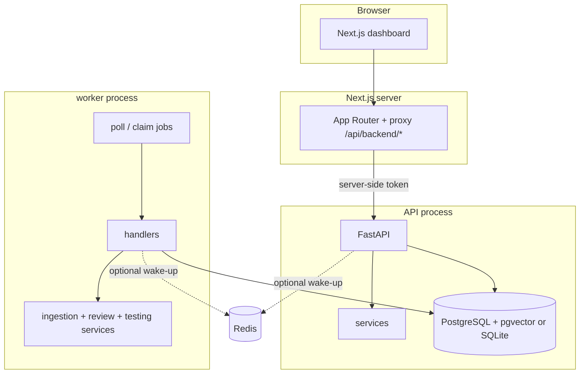
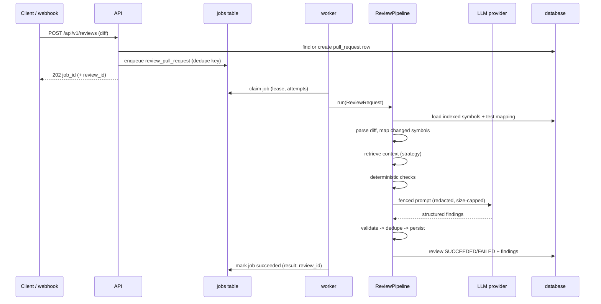

# Architecture

This document describes what the code does today. Remaining limitations (for
example the missing HNSW index and live GitHub installation) are called out where
they matter rather than drawn as if they existed.

## Goals that shaped the design

- **Runs with nothing installed.** SQLite, a database-backed job queue, deterministic
  hashing embeddings and a deterministic mock LLM mean a fresh checkout works without
  Docker, Redis or paid credentials. PostgreSQL + pgvector and Redis are opt-in.
- **Every claim is traceable.** A finding stores its detector, rule, evidence and the
  exact line it anchors to, plus a rejection reason when it was discarded. The trace
  endpoint also states what was *not* checked.
- **Failure is a state, not a silent zero.** Provider failures, skipped checks and
  unavailable sandboxes are recorded with reasons.

## Processes

PatchLens ships as two backend processes, a Next.js frontend and a one-shot
migration step:



Redis is never required for correctness: the durable queue is the `jobs` table, and
Redis (when configured) only shortens the latency between "a job was queued" and "a
worker noticed". The worker subscribes to `patchlens:jobs` and also polls with a
bounded interval, so a missed publish cannot strand work. The frontend proxy keeps
`API_AUTH_TOKEN` on the server; the browser never receives it.

## Review data flow



The pipeline records a stage (`queued → parsing → mapping → retrieval → checks → llm
→ validation → persistence → succeeded/failed`) and commits findings in one
transaction with the review. A review that succeeds is idempotent per
`(pull_request, commit_sha, strategy)`: a repeated request returns the stored result
instead of reviewing twice. A failed review can be retried; the unique constraint only
applies to committed, successful rows.

## Ingestion

`services/ingestion` walks a checkout with an exclusion policy (VCS directories,
virtualenvs, caches, build outputs, vendored trees, binaries, secret dotfiles), then
parses `.py` files with `ast`. The parser extracts modules, classes, functions,
methods, docstrings, signatures, decorators, imports, call edges and line ranges.
Test functions are detected by file name and function name conventions.

Each run writes an immutable `repository_version` (commit SHA or content hash) and
`code_symbols` scoped to it. Two performance properties fall out of the schema:

- An unchanged tree hash short-circuits the run (`up_to_date=true`).
- Embeddings are keyed by `(content_hash, provider, model, dim)`, so re-indexing a
  new commit reuses vectors for symbols that did not change.

## Retrieval

All strategies implement the same interface and return the same result shape, which
is what makes them comparable in the evaluation harness.

- `bm25`: an in-process Okapi BM25 with field-weighted documents (name, signature,
  docstring, body excerpt). The tokenizer splits `snake_case` identifiers into the
  whole identifier plus its parts so `safe_divide` is findable as `divide`.
- `semantic`: cosine similarity over vectors. On SQLite this is an in-process scan
  (`portable_scan`); on PostgreSQL it is a pgvector `<=>` query. The vector column is
  unconstrained and there is no HNSW index yet, so the database path is an exact
  scan, not an ANN query. Both paths were exercised on 2026-10-21 (SQLite and
  PostgreSQL 16 + pgvector).
- `hybrid`: reciprocal rank fusion (`k=60`) of the BM25 and semantic rankings.
- `hybrid_rerank`: RRF candidates re-scored by a heuristic reranker with fixed,
  documented weights (identifier overlap, path proximity, kind match). It is not a
  trained model and is labelled that way.
- `static`: exact identifier/path/kind matching, an unranked baseline rather than a
  semantic or graph strategy.

## Deterministic checks

Rules are split by what they need:

- **Line rules** work from the diff alone (for example `subprocess ... shell=True`,
  bare `except`, SQL interpolation inside `execute(...)`). They are the fallback when
  no checkout is available.
- **AST rules** need the post-change file text (unused imports, mutable defaults,
  N+1 query patterns, missing tests). They are skipped, with a reason, when the file
  content is unavailable.

The review engine reconstructs the new side of a changed file from the diff when the
checkout is still at the base revision, and refuses to analyse content that matches
neither side. Without that step, AST rules would confidently analyse pre-change code.

A rule is one entry in the catalogue even when it has both a line and an AST
implementation; the two implementations must agree on category, severity and
verification status (a unit test enforces it).

## LLM boundary

`LLMProvider.complete(LLMRequest) -> LLMCompletion` is the only interface. Two
implementations exist:

- `MockLLMProvider` — deterministic, rule-based, `is_mock=True`.
- `OpenAICompatibleProvider` — HTTP `POST /chat/completions`, tries structured
  output modes in order (`json_schema → json_object → plain`), retries transient
  failures with backoff, and normalises everything into the same Pydantic schema.
  `is_mock=False`.

Repository content is treated as untrusted input. Prompts place snippets, docstrings
and file paths inside labelled fences, secrets are redacted before rendering, the
context is size-capped, and the model's JSON is only a *proposal*: it must pass the
validation boundary (allowed paths, added lines, line ranges, evidence excerpts,
duplicate checks, prompt-injection rejection) before it is stored or published.

## Persistence

18 tables, grouped by purpose:

| Group | Tables |
| --- | --- |
| repositories | `repositories`, `repository_versions`, `code_symbols`, `symbol_edges`, `code_embeddings` |
| review | `pull_requests`, `reviews`, `findings`, `finding_feedback` |
| jobs | `jobs`, `job_events` |
| GitHub | `github_installations`, `webhook_deliveries` |
| testing | `test_candidates` |
| evaluation | `eval_datasets`, `eval_cases`, `eval_runs`, `eval_case_results` |

Portability decisions:

- `UTCDateTime` normalises timezone handling across SQLite and PostgreSQL.
- `VectorColumn` stores JSON text on SQLite and an unconstrained `vector` on
  PostgreSQL. The dimension is validated in Python. A fixed-dimension column plus an
  HNSW index is planned; until then the Postgres semantic path is an exact scan
  inside the database.
- Jobs use `dedupe_key` (immutable identity) plus a nullable unique `dedupe_slot`
  that is cleared on terminal success/failure but retained while retrying, so a
  crash cannot create a duplicate active job.

## Job lifecycle

`queued → running → succeeded | failed | canceled`, with `retrying` as a stage while
the row is queued again. Each attempt increments `attempts`, records an event and
sets `next_run_at` with exponential backoff. Workers claim jobs with a lease and
heartbeat; expired leases are recovered on startup and periodically, so a killed
worker does not strand work. Timeouts are enforced per job (`SIGALRM` where
available). Concurrency is limited to one job on SQLite (single-writer) and can be
raised on PostgreSQL.

After a queue transaction commits, the enqueue path publishes a best-effort Redis
notification; the worker subscribes to the same channel and still polls on a bounded
interval. A Redis outage therefore adds latency, not lost work.

## Test intelligence

Generation turns changed symbols (or explicit indexed symbols) into candidate tests.
Each row in `test_candidates` stores the target, source, suggested path, provider and
model, status, and execution metadata. The bundled deterministic mock emits an
importability smoke suite; a real provider can emit behavioural tests, but no paid
provider was used here.

Execution is resolved at request time into one of three tiers:

- `disabled` (default): no process is started; the candidate is stored as
  `execution_disabled` with the reason and `executed_at` stays null.
- `subprocess`: requires `ALLOW_LOCAL_TEST_EXECUTION=true`. It applies a timeout, a
  sanitised environment, a fresh working directory and best-effort POSIX limits. It
  is explicitly **not** a security boundary.
- `docker`: runs `patchlens-test-runner:latest` with `--network none` by default,
  read-only repository and test mounts, `--cap-drop ALL`, `no-new-privileges`, a
  read-only root filesystem, a `noexec` tmpfs, memory/CPU/PID limits, a timeout and
  output caps. If the Docker CLI or daemon is unavailable the candidate is
  `execution_disabled` with the probe error; a missing image or container failure is
  `error` with the captured output.

`executed_at`, `exit_code` and output are written only after a process was actually
started. A missing sandbox is never rendered as `passed`. The evaluation harness
reuses the subprocess primitive and reports execution metrics as `UNKNOWN` unless
that tier is explicitly enabled; it does not use the Docker tier.

## GitHub flow

```
GitHub App webhook (HMAC verified, delivery id unique)
  → pull_request opened/reopened/synchronize
  → resolve registered repository + local checkout/index
  → upsert pull_request, enqueue review (dedupe: repo + head SHA)
  → worker: app JWT → installation token → fetch PR diff
  → review pipeline (same path as API/CLI reviews)
  → publisher: eligible findings → one COMMENT review + neutral check run
  → per-finding publish_state / publish_detail, review publish_state
```

The audit trail is `webhook_deliveries` (signature seen, payload hash, status,
reason, job id), not application logs alone. `GitHubPublisher` implements the same
`Publisher` protocol as any future integration; when GitHub is unconfigured the
pipeline records `publish_state=skipped` with the reason. See
[GITHUB.md](GITHUB.md) for permissions, setup and failure semantics.

## Extension points

- **Publisher** (`services/review`): publication is a protocol. No publisher means
  `publish_state=skipped` with an explicit metadata reason. `GitHubPublisher`
  (`services/github/publisher.py`) implements it with least-privilege installation
  tokens, comment filtering and per-finding publication state.
- **Retrieval strategy**: add a strategy to the enum and the service; the evaluation
  harness picks it up because it consumes the same interface.
- **LLM/embedding providers**: implement the base class; the factory maps settings
  names to constructors. Provider/model identity is persisted with each artefact.

## Frontend

`frontend/` is a Next.js 16 App Router application (React 19, TypeScript strict,
Tailwind 4). It renders Overview, Repositories, Reviews, Findings, Test
intelligence, Evaluation, Jobs and Settings, plus create/detail routes.

- Data is fetched client-side through `/api/backend/*`, a same-origin route handler
  that forwards to `PATCHLENS_API_URL` and injects `PATCHLENS_API_TOKEN` server-side.
  The token is never sent to the browser.
- Every page has real loading, error and empty states. Undefined metrics render as
  `UNKNOWN`; a dataset without a run renders as `NOT RUN`.
- The dashboard reads aggregate numbers from `GET /api/v1/overview`; evaluation runs
  are excluded from workspace counts and shown on the Evaluation page.
- The UI labels mock provider output and verification status instead of presenting
  suggestions as confirmed defects.
- 26 Vitest tests cover formatting, badges, the proxy route and feedback controls;
  lint, typecheck and the production build are part of `make ci`.

## Deployment

`docker-compose.yml` runs PostgreSQL 16 + pgvector, Redis, a one-shot Alembic
migration, the API and a worker. The API healthcheck probes `/healthz`; the worker
has no HTTP probe because it does not serve HTTP. Both long-running services use the
same non-root image and run with `AUTO_CREATE_SCHEMA=false`, so migrations are the
only schema owner.

Verified on 2026-10-21: `docker compose up -d --build` brought the stack up,
migrations completed, `/readyz` returned 200, the worker logged Redis wake-ups, the
API reported `semantic_backend=pgvector`, and retrieval/review/test-generation
evaluation runs succeeded. The Docker test-runner image is separate from the
API/worker image and contains only pytest.
